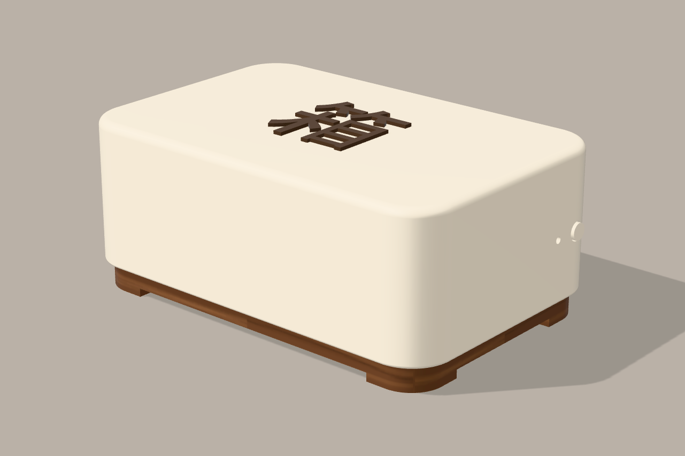

  

<h3 align="center">Vos souvenirs restent à la maison.</h3>

  <a href="https://antoninche.github.io/hako/"><strong>Voir le site</strong></a> ·
  <a href="https://antoninche.github.io/hako/installer/demonstration/">Essayer la démonstration d’installation</a> ·
  <a href="https://antoninche.github.io/hako/la-box/">Ce qu’il y a dans la box</a>

---

**HAKO** est une petite box qui garde les photos et les fichiers d’une famille chez elle, au lieu de les confier à un service en ligne. Nous l’assemblons en Provence et nous l’installons chez nos clients, de Salon-de-Provence à Toulon.

Hako (箱) veut dire « boîte » en japonais.

## Ce que fait la box

- **Photos et vidéos** avec [Immich](https://immich.app), une alternative libre à Google Photos.
- **Fichiers** avec [Nextcloud](https://nextcloud.com), une alternative libre à Google Drive ou Dropbox.
- **Rien ne quitte la maison.** Sans votre demande, nous n’avons aucun accès à vos données.
- **Des logiciels libres**, sur un Raspberry Pi 5 avec un disque SSD de 1 To, ou plus en option.

## Où en est le projet

| Partie | État |
| --- | --- |
| Site internet | En ligne : présentation, offres, formulaire de commande en démonstration, FAQ |
| Guide d’installation | En ligne, pour l’envoi hors de notre zone, qui ouvrira bientôt |
| Démonstration de la première installation | En ligne, avec une box simulée |
| Prototype de la box | Dessiné en 3D, images de synthèse sur le site |
| Système de la box (HakOS) | Image Raspberry Pi OS avec Immich et Nextcloud, construite et vérifiée sur ordinateur ; premier essai sur un Raspberry Pi 5 à venir |

**Feuille de route :** d’abord Hako Home, installée chez vous dans notre zone. Ensuite, l’envoi et l’installation par vous-même avec notre guide. Puis Hako Pro, pour les petites entreprises.

## Nos dépôts

- [**hako**](https://github.com/antoninche/hako) : le site. Astro et TypeScript, sans cookie ni traceur, avec plus de 600 tests automatiques (accessibilité, sécurité, contenu). Il rejoindra cette organisation prochainement.

## L’équipe

Trois étudiants d’Aix-Marseille, chacun responsable d’un domaine :

- **Antonin Chenavaz**, logiciel et système · [LinkedIn](https://www.linkedin.com/in/antonin-chenavaz-9b9215421/)
- **Maxime Pollaud**, commerce et relation client · [LinkedIn](https://www.linkedin.com/in/maxime-pollaud-488a77397/)
- **Martin Dugail**, design et finance · [LinkedIn](https://www.linkedin.com/in/martin-dugail-15a5a742b/)
